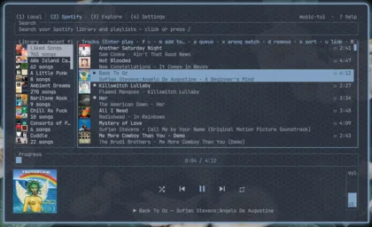
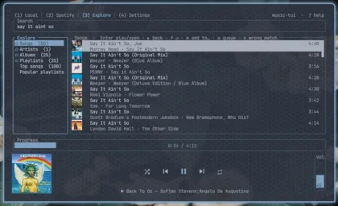
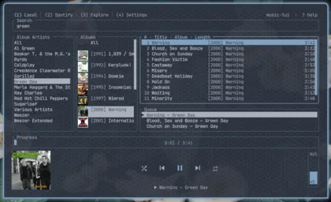

# music-tui

> Companions: **[music-android](https://github.com/adelmonte/music-android)** on the phone and
> **[music-kodi](https://github.com/adelmonte/music-kodi)** in Kodi, with your playlists, radio and podcasts.

<p align="center">
  
</p>

<table align="center">
  <tr>
    <td align="center"><a href="screenshots/spotify.png"></a><br><sub><b>Spotify</b> · your library, streamed</sub></td>
    <td align="center"><a href="screenshots/say-it-aint.png"></a><br><sub><b>Explore</b> · search anything</sub></td>
    <td align="center"><a href="screenshots/warning.png"></a><br><sub><b>Local</b> · your music folder</sub></td>
  </tr>
</table>

A keyboard and mouse-driven terminal music player built with [ratatui](https://ratatui.rs).
It scans a local music library, browses it by album artist / album / track, manages a
play queue and playlists, and plays audio with optional gapless crossfade. In
[kitty](https://sw.kovidgoyal.net/kitty/) it also renders album art and oversized
transport icons.

Optionally it can also take over from Spotify: import your Spotify library from a CSV
export, discover new music, and stream any song by fetching it from YouTube. No
Spotify, YouTube, or Deezer account is needed.

## Features

- Three-column browser: album artists → albums (by year) → tracks, with a live search bar
- Play queue and saved playlists
- Gapless playback with a configurable crossfade
- Clickable, draggable progress and volume bars
- Album art (kitty graphics protocol) with an on-disk thumbnail cache
- Mouse support throughout; resizable panes (keyboard and drag)
- Configurable color theme
- Remembers where you left off (queue, tab, selections, even the position mid-song)
- **Spotify tab** (optional): your imported Spotify library and playlists, playable
  through YouTube, with likes, custom playlists, and live linked playlists
- **Explore tab** (optional): search, charts, "For you" recommendations, and song radios
  of similar music
- **Radio tab** (optional): about 50,000 internet radio stations, with the song that's on
  air and favorites
- **Podcasts tab** (optional): search, subscriptions, new episodes, resume where you left
  off, and playback speed

## Recommended

- A [Nerd Font](https://www.nerdfonts.com/) for the transport icons
- **kitty ≥ 0.40** for album art and 2× transport icons (other terminals run fine; those
  two features degrade gracefully)

## Requirements for streaming

The Spotify, Explore, Radio and Podcasts tabs need these on your `PATH`:

- [`yt-dlp`](https://github.com/yt-dlp/yt-dlp): finds and downloads songs (Spotify and Explore)
- [`ffmpeg`](https://ffmpeg.org/): writes songs out as they download, and plays radio
  stations and podcast episodes

On Arch: `sudo pacman -S yt-dlp ffmpeg`. The local library works without them.

## Install

### Arch Linux (AUR)

[`music-tui`](https://aur.archlinux.org/packages/music-tui) is available on the AUR:

```sh
yay -S music-tui
```

### Build from source

```sh
cargo run --release
```

Building needs `cargo` and `cmake` (the Opus decoder is compiled in).

On first launch, open the **Settings** tab (the last tab), set your music directory (`e`,
defaults to `~/Music`), and scan it (`r`). The browser populates once the scan completes.

## Supported formats

MP3, FLAC, WAV, AIFF, Ogg Vorbis, and MP4/AAC/ALAC are decoded via
[Symphonia](https://github.com/pdeljanov/Symphonia); Ogg Opus is decoded with libopus.
Tags and cover art are read with [lofty](https://github.com/Serial-ATA/lofty).

## Mouse and keyboard

Everything works with the mouse:

- **Right-click** any song, album, artist, playlist or queue entry for its menu: play,
  play next, add to queue, like, add to a playlist, song radio, go to the artist or album,
  sort, remove. Each item shows its key on the right, so the menu doubles as a cheat sheet.
- **Double-click** plays; **middle-click** adds to the queue.
- Click tabs and the playback buttons; drag the progress bar, the volume, the scrollbars
  and the pane dividers.

Press `?` (or click **? keys** in the top-right) to show the keys for the focused pane in
a row at the bottom, and each tab's key. `F1` lists every shortcut.

| Key | Action |
| --- | --- |
| `1`–`7` | switch tab (Local · Spotify · Explore · Radio · Podcasts · Local Playlists · Settings; hidden tabs are skipped) |
| `/` | search (each tab keeps its own search); `Esc` clears it |
| `Tab` / `Shift-Tab` | cycle focus in every tab: search → panes → queue → progress → buttons → volume |
| `↑↓` `←→` | move / change pane |
| `Enter` | open artist/album · play track |
| `a` / `A` | add to the queue / play next |
| `l` | like / unlike (`f` works too) |
| `m` | add to a playlist |
| `g` | **Go to…** song radio, artist, album |
| `G` | keep going: queue similar songs when the queue runs out |
| `Shift+F10` | the right-click menu for the highlighted item |
| `Q` / `c` | show / hide the queue / clear it |
| `Space` · `n` / `p` | play / pause · next / previous |
| `s` / `r` | shuffle / repeat (off → all → one) |
| `+` / `-` · `[` / `]` | volume · seek −/+ 5s |
| `Alt+]` / `Alt+[` | grow / shrink the focused pane |
| `q` / `Ctrl-C` | quit |

Vim keys (`h`/`j`/`k`/`l`, `J`/`K`) are off by default; turn them on in Settings. Every
shortcut can be changed under `[keys]` in the config (see below).

### The queue

Playing a track (`Enter` or double-click in the Tracks column) **replaces** the queue with
that album and starts at the chosen track; double-clicking an artist or album plays all of
it the same way. To build up a queue without replacing it, use `a` instead: it appends the
highlighted track, album, or artist.

With the Queue panel focused:

| Key | Action |
| --- | --- |
| `Enter` | play that item |
| `A` | play it next |
| `d` / `Delete` | remove the item |
| `Shift+↓` / `Shift+↑` | move the item down / up (`J` / `K` with vim keys) |
| `c` | clear the whole queue |

In the **Local Playlists** tab (can be hidden in Settings): `n` save the current queue as a new playlist, `a` append the
queue to the selected playlist, `d` delete a playlist, `x` remove a track, `Enter` play.

## Spotify and streaming

Turn on the **Spotify** and **Explore** tabs in Settings. Neither one logs in to anything:
your library comes from a CSV export you make once, songs are found on YouTube Music and
downloaded with `yt-dlp`, and Explore uses Deezer's public API.

### Exporting your Spotify library

1. Go to [exportify.app](https://exportify.app/) ([source](https://github.com/watsonbox/exportify))
   and click **Get Started**. Log in with Spotify and approve the read-only access it asks
   for. This uses Spotify's official API, so it's the same as using any third-party
   Spotify app.
2. Click **Export All** at the top of the playlist list. You get a zip with one CSV per
   playlist, plus `Liked_Songs.csv`.
3. Unzip it into `~/Music/spotify-export/` (or anywhere else; set the folder under
   Settings → Spotify → Export file / folder).
4. Open the **Spotify** tab. The export is imported on first launch.

To pick up songs you add on Spotify later, export again, replace the folder's contents, and
use Settings → Spotify → Re-import export. New songs are added to the
existing lists. Likes, songs you added and lists you made in music-tui are kept.

A single [TuneMyMusic](https://www.tunemymusic.com/) CSV export works too: point the
**Export file / folder** setting at the `.csv` file.

Spotify's own generated playlists (Release Radar, Discover Weekly) change every week, so an
export is only a snapshot. To keep them live, press `u` in the Spotify tab and paste the
playlist's share link (in Spotify: **⋯ → Share → Copy link to playlist**). Linked playlists
are marked `↻` and refresh on every launch. They replace the imported snapshot of the same
name. Only the first 100 songs of a linked playlist are read.

### How songs play

The first time you play a song, music-tui finds it on YouTube Music and downloads YouTube's
best audio stream (Opus, about 140 kbps). It prefers plain audio uploads to music videos
and live or remixed versions. A song starts playing once a few seconds have downloaded,
and the next song in the queue is fetched ahead of time. Downloads always finish, even
if you skip the song or close music-tui; anything cut off is picked up on the next launch. If a
match is wrong, press `x` on the song to reject that video and fetch the next-best one.

Downloads are tagged (title, artists, album artist, album, track number, year, ISRC, and
cover) and filed like a music library:

```
~/.cache/music-tui/spotify/music/Album Artist/[Year] Album/NN Title.opus
```

To keep songs, copy their folders into your music directory (Settings → Downloaded songs →
`Enter` opens the folder).

### Spotify tab keys

| Key | Action |
| --- | --- |
| `Enter` | play the list from the highlighted song |
| `l` | like / unlike (Liked Songs) |
| `m` | add to a playlist (or a new one) |
| `a` | add the song (or the whole list) to the queue |
| `d` | remove the song from the list, or unlink a linked playlist |
| `u` | link a Spotify playlist URL |
| `o` | cycle sort order (recently added, oldest, title, artist, album) |
| `g` | Go to… song radio, artist page, or album page (in Explore) |
| `x` | wrong song? Confirms, then fetches the next-best YouTube match |
| `Tab` | switch between the lists and the songs |
| `/` | search the open list |

### Explore

Search for songs, artists, albums, and playlists (Deezer, with YouTube Music as a
fallback). The home page is rebuilt from your likes every launch:

- **For you**: a mix from the artists you like most
- **Because you liked …**: a song radio for each of your three latest likes, minus songs
  you've already liked
- **New releases for you**: albums, EPs and singles from the last four months by artists
  you like
- **Top songs**, **Top albums**, and **Popular playlists** from Deezer's charts

`Enter` plays a song or opens an album/artist/playlist, `Backspace`/`Esc` goes back,
and `l`, `m`, `a`, and `x` work as in the Spotify tab. `S` saves the open list as a playlist
in your Spotify-tab library.

### Song radio

Press `g` on any song, in any tab, and choose **Song radio** (or press `g` twice) to build
a radio of about 50 songs with a similar sound and mood. It comes from YouTube Music's "start radio" mix, and each song is matched on
Deezer for proper metadata and covers. It appears right away in Explore's sidebar
(marked ◉) and fills in after about 20 seconds. The last five radios stay in the sidebar. Songs you already have locally play from your own files.

**Keep going** (`G`, the Go to… menu, or Settings → Playback) does this automatically: when the last song in
the queue starts, a radio built from it adds up to 25 more songs. It's off while shuffle or
repeat is on.

## Radio

Stations come from [Radio Browser](https://www.radio-browser.info/), a free, community-run
directory of about 50,000 stations. The tab opens on popular stations, the ones popular in
your country (from your locale), the most voted, and a few genres. Search finds stations by
name or by genre (`jazz`, `news`, `lofi`).

`Enter` or double-click plays a station; `l` adds it to (or removes it from) **Favorites**,
which stay at the top. Most stations send the name of the song on air, which shows as now
playing; right-click the station to look that song up in Explore.

## Podcasts

Shows come from Apple's podcast directory (search and the top chart, no account needed)
and are read straight from their RSS feeds. Open a show to see its episodes, newest first.

| Key | Action |
| --- | --- |
| `Enter` | open a show · play an episode |
| `l` | subscribe / unsubscribe (on a show) · mark played / unplayed (on an episode) |
| `>` / `<` | faster / slower (0.5× to 3×, pitch is kept; also in Settings) |
| `[` / `]` | back 10 s / ahead 30 s |

**Subscriptions** and **New episodes** (the latest across your subscriptions, refreshed
every launch) sit at the top of the tab. Every episode remembers where you stopped and
picks up from there; rows show the time left, and finished episodes are ticked (✓).
Episodes stream; nothing is downloaded.

Both tabs can be turned off in Settings → Tabs.

## Remote control

While music-tui is running, you can control it from any other terminal or bind these flags
to media keys in your window manager:

```sh
music-tui --play-pause   # toggle play / pause
music-tui --next         # skip to the next track
music-tui --previous     # go to the previous track
music-tui --volume-up    # raise volume by 5%
music-tui --volume-down  # lower volume by 5%
music-tui --repeat       # cycle repeat mode (off → all → one)
music-tui --shuffle      # toggle shuffle
```

The running instance listens on a Unix domain socket
(`$XDG_RUNTIME_DIR/music-tui.sock`, e.g. `/run/user/1000/music-tui.sock`).
The flag invocation connects, sends the command, and exits immediately.

## Configuration

Settings live in `config.toml` (path shown in the Settings tab). Edits are applied on
restart; comments you add are preserved. Example:

```toml
music_dir = "/home/you/Music"

[theme]
accent = "cyan"         # names ("cyan"), hex ("#ff8800"), or 256-color index ("39")
selection_fg = "black"
border = "darkgray"
dim = "darkgray"
muted = "gray"
menu_bg = "#2e3440"       # right-click menu background
menu_highlight = "#81a1c1"

[layout]
columns = [25, 30, 45]  # browser column widths (%), kept in sync with on-screen resizing
queue_pct = 28          # queue height (%) within the third column

[playback]
gapless_fade_secs = 3.0 # crossfade seconds between tracks (0 = hard cut)
keep_going = false      # queue similar songs when the queue runs out

[ui]
big_transport_icons = true  # 2x icons via the kitty text-sizing protocol
cache_all_art = false       # pre-cache all cover thumbnails in the background
sort_articles = true        # display/sort "The Doors" as "Doors, The"
show_album_thumbnails = true
show_playlists_tab = true   # the Local Playlists tab
shared_search = false       # one search for all tabs (default: each tab keeps its own)
vim_keys = false            # h/j/k/l and J/K on top of the arrows
show_hints = false          # keep the row of key hints visible (otherwise ? shows it)

[spotify]
enabled = false                          # the Spotify tab
csv = "/home/you/Music/spotify-export"   # export folder (or a single CSV file)
links = []                               # linked playlist URLs (added with `u`)

[browser]
enabled = true                           # the Explore tab

[radio]
enabled = true                           # the Radio tab

[podcasts]
enabled = true                           # the Podcasts tab
speed = 1.0                              # playback speed for episodes

# Change any shortcut: an action name and its keys. An empty list unbinds it.
# The names are in src/keys.rs; F1 in the app shows what each key does.
[keys]
like = ["l"]
play_next = ["A", "Ctrl+N"]
sort = []
```

## Files and directories

The application follows the platform's standard directories (paths below are Linux/XDG;
macOS and Windows use their respective conventions via the
[`directories`](https://crates.io/crates/directories) crate).

| Path | Purpose |
| --- | --- |
| `~/.config/music-tui/config.toml` | user configuration (created on first run) |
| `~/.local/share/music-tui/library.db` | SQLite index of the scanned library |
| `~/.local/share/music-tui/playlists.toml` | saved local playlists |
| `~/.local/share/music-tui/streaming.toml` | Spotify-tab library: imported lists, likes, your playlists |
| `~/.local/share/music-tui/radio.toml` | favorite radio stations |
| `~/.local/share/music-tui/podcasts.toml` | podcast subscriptions, where you stopped in each episode, finished episodes |
| `~/.local/share/music-tui/spotify_matches.toml` | which YouTube video each song uses, and rejected ones |
| `~/.local/share/music-tui/session.toml` | queue and position to resume from |
| `~/.cache/music-tui/covers/` | resized thumbnails of oversized local album art |
| `~/.cache/music-tui/spotify/music/` | downloaded songs, filed by artist and album |
| `~/.cache/music-tui/spotify/audio/` | links from song IDs to the downloaded files |
| `~/.cache/music-tui/spotify/covers/` | album covers for streamed songs (one per album) |
| `$XDG_RUNTIME_DIR/music-tui.sock` | Unix socket for CLI remote control |

Your music files are only ever read, never modified. Everything under `~/.cache` can be
deleted safely: songs re-download and covers regenerate on demand. `streaming.toml` holds
your likes and playlists, so it's the one file worth backing up.

## License

Released under the [MIT License](LICENSE).
